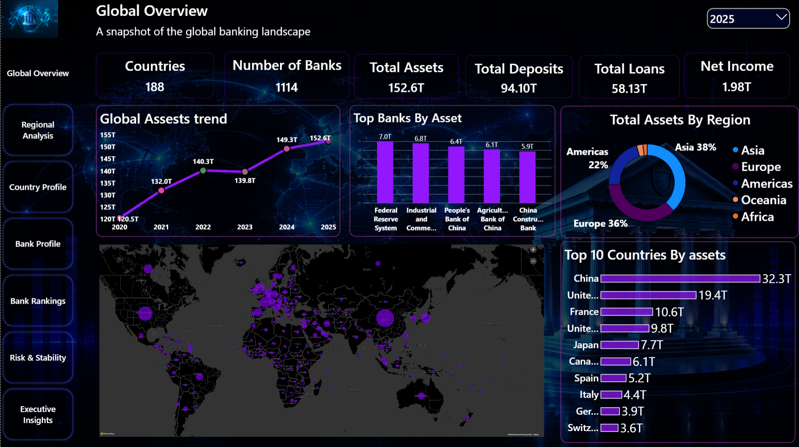
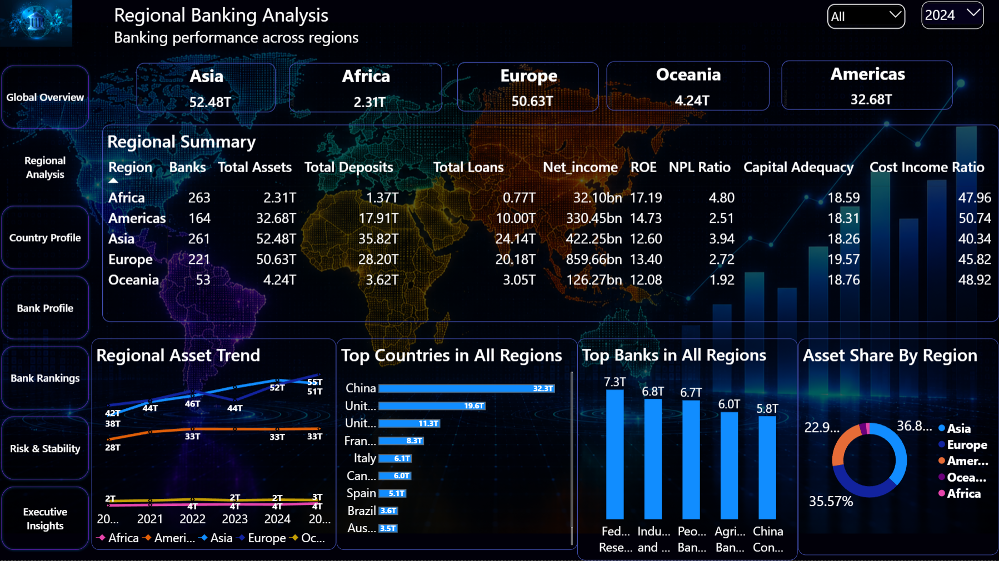
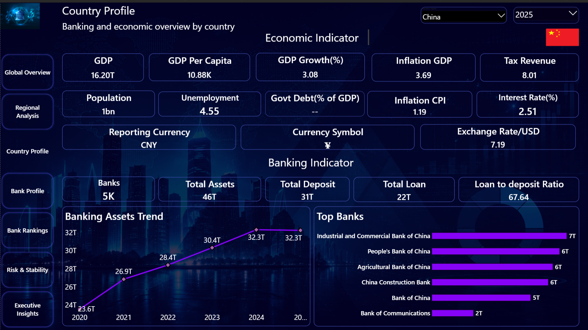
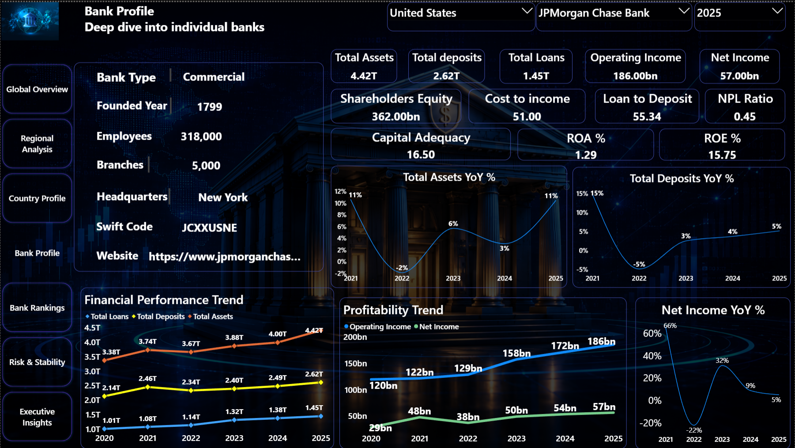
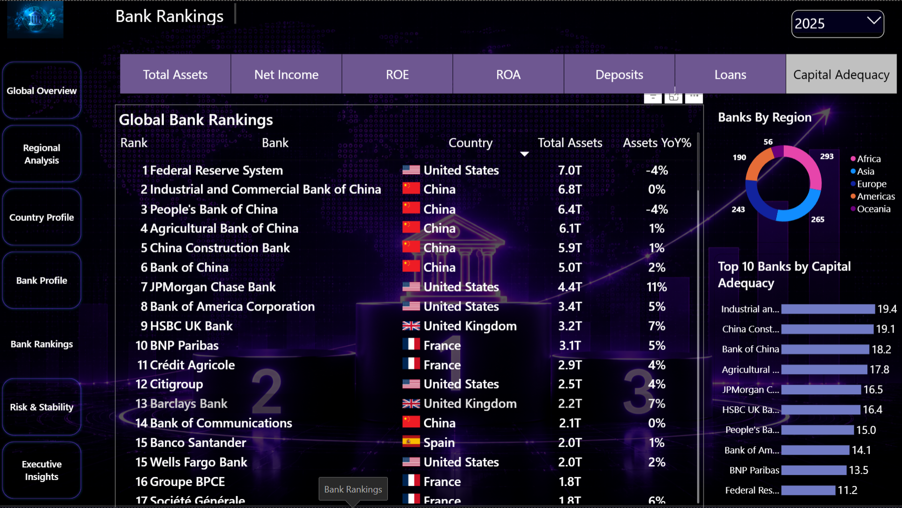
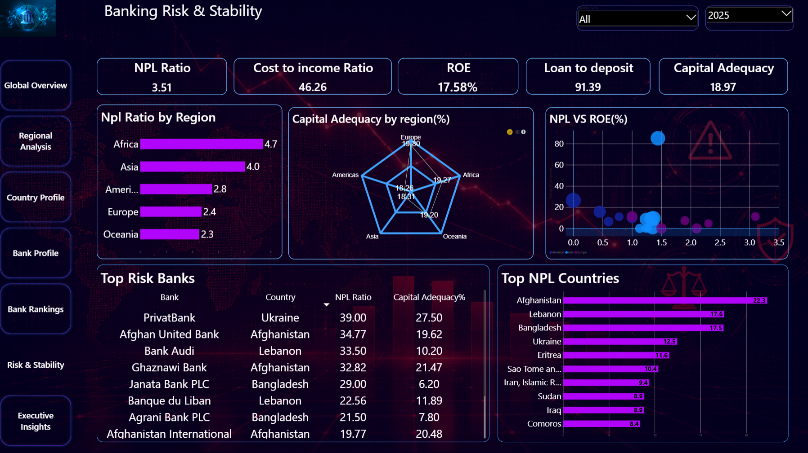

# Global Banking Intelligence

Global Banking Intelligence is a banking analytics porfolio project covering countries, regions and banks from 2020 to 2025.

The project combines banking financial data and economic indicators to analyze assets, deposits, loans, profitability, growth and risk.

## Tools

- Python
- PostgreSQL
- Excel
- Power BI
- DAX 
- DBeaver
- VS Code

## Python

Python was used for data extraction, web scraping, cleaning, transformation, validation, financial data processing and synthetic data generation.

Libraries used:

- pandas
- NumPy
- requests
- BeautifulSoup 4
- Playwright
- lxml
- PyMuPDF
- pdfplumber
- fake-useragent
- Loguru

Automated bank financial extraction was only possible for a limited number of countries and banks due to differences and limitations in public data availability and source structures.

## Data

GBIP uses a hybrid dataset containing official and synthetic data.

Original data was collected from publicly available sources.

Synthetic values were used only where reliable public data was unavailable.

The original bank financial datasets are preserved separately in the `Data/Raw/` folder. Unavailable original values are marked as `Pending Public Data`.

## Database

PostgreSQL was used as the main database for storing and analyzing the project data.

SQL was used for:

- Data analysis
- Data quality checks
- Validation
- Bank rankings
- Country and regional analysis
- Growth analysis
- Profitability analysis
- Risk analysis
- SQL views
- Summary datasets

The database was developed using pgAdmin and DBeaver.

## Power BI

Power BI was used for the final data model, DAX calculations and interactive dashboard.

The dashboard contains:

- Global Overview
- Regional Analysis
- Country Profile
- Bank Profile
- Bank Rankings
- Risk & Stability
- Executive Insights

## Dashboard

### Global Overview

Overview of global banking scale and key financial indicators.

### Regional Analysis

Comparison of banking performance across regions.

### Country Profile

Detailed analysis of a country's banking sector and economic indicators.

### Bank Profile

Financial performance and key indicators for an individual bank.

### Bank Rankings

Comparison and ranking of banks across major financial metrics.

### Risk & Stability

Analysis of banking risk, capital strength and stability indicators.

Database schema and Power BI model relationship diagrams are also included in the `Images/` folder.

## Documentation

Detailed project documentation is available in the `Docs/` folder, including:

- Data Dictionary
- Methodology
- SQL Analysis
- Data Quality Documentation

